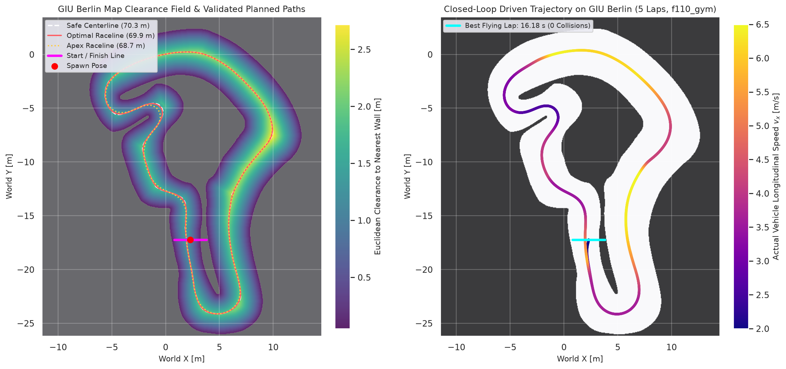

# GIU Berlin Map Validation & Path Planning — `AME-RoboRacer-Project-YourStudentID`

- **Course / Competition:** AME RoboRacer Competition — GIU Berlin (Winter Semester 2026)
- **Author:** `YourName` (`YourStudentID`)
- **Primary Package:** `src/planning/simple_planner/`

---

## 1. Ground-Truth GIU Berlin Map Analysis

Rather than assuming track dimensions or inventing coordinates, all map geometry was extracted directly from the official F1TENTH / GIU Berlin occupancy grid (`f1tenth_gym_ros/maps/berlin.yaml` and `src/planning/simple_planner/maps/berlin.yaml`) and cross-verified cell-by-cell (`360,000 / 360,000` pixels identical) across `f1tenth/f1tenth_gym`, `GIU-F1Tenth/f1tenth_maps`, and `GIU-F1Tenth/racing_playground`:

| Parameter | Exact Measured Value | Source / Verification |
| :--- | :--- | :--- |
| **Grid Dimensions ($W \times H$)** | `600 x 600` pixels (`30.00 m x 30.00 m`) | `berlin.{png,pgm}` (`mode='L'`, 8-bit) |
| **Spatial Resolution ($r$)** | `0.050000 m/px` (`5.0 cm/cell`) | `berlin.yaml` |
| **Map Origin ($x_0, y_0, \theta_0$)** | `[-11.606540, -26.520793, 0.000000]` | Lower-left cell world coordinates in `map` frame |
| **World Coordinate Bounds** | $x \in [-11.6065, +18.3435]\text{ m}$, $y \in [-26.5208, +3.4292]\text{ m}$ | Exact `OccupancyGridMap.grid_to_world()` |
| **Drivable Free Area** | `107,954` cells = **`269.885 m^2`** | `occ_prob < free_thresh (0.196)` |
| **Occupied Wall Components** | **`2` connected components**, **`0` interior obstacles** | Outer wall (`227,977 px`) + inner island (`24,069 px`) |
| **Track Corridor Half-Width** | Min **`~0.985 m`** (full width `~1.97 m`), Max **`~2.68 m`** (full width `~5.36 m`) | Euclidean Distance Transform (`scipy.ndimage.distance_transform_edt`) |
| **Vehicle Spawn Pose** | $x = 2.2933\text{ m},\; y = -17.2435\text{ m},\; \theta = -1.4965\text{ rad}$ (`-85.74 deg`) | Southbound straight; center clearance `1.00 m` |
| **Start / Finish Segment** | $P_1 = [0.80, -17.25]\text{ m} \rightarrow P_2 = [3.80, -17.25]\text{ m}$ | Spans full `3.0 m` corridor orthogonal to spawn heading |

### Critical 1-Bit PNG Defect Resolved
Upstream `GIU-F1Tenth/f1tenth_maps/maps/berlin.png` is saved as a 1-bit palette-less image (`PIL.Image.mode == '1'`). Inside `f110_gym`'s `ScanSimulator2D.set_map()`, pixels are cast directly to `float` (`0.0` black, `1.0` white instead of `255.0`), causing `(255.0 - dt_img) / 255.0 > 0.65` to classify **100% of the map as solid wall** (`obs['collisions'][0] == True` at spawn). Converting `berlin.png` and `berlin.pgm` to 8-bit grayscale (`mode='L'`) and enforcing automatic conversion inside `resolve_gym_map_path()` completely eliminates this failure.

---

## 2. World $\leftrightarrow$ Occupancy Grid Coordinate Transforms

Implemented in `src/planning/simple_planner/simple_planner/map_utils.py` (`OccupancyGridMap`) and unit-tested to `< 1e-12 m` round-trip precision:

$$\text{col}(x) = \frac{x - x_0}{r}, \qquad \text{row}(y) = (H - 1) - \frac{y - y_0}{r}$$

$$x(\text{col}) = x_0 + r \cdot \text{col}, \qquad y(\text{row}) = y_0 + r \cdot (H - 1 - \text{row})$$

Wall clearance $d_{\text{wall}}(x, y)$ is evaluated continuously at any floating-point world position via bilinear interpolation over the exact Euclidean Distance Transform grid $D = r \cdot \operatorname{EDT}(\text{free\_mask})$.

---

## 3. Two-Stage Path Planning & Speed Profile Generation

Implemented in `src/planning/simple_planner/simple_planner/path_planner.py`:

1. **Stage 1 — Topological Harmonic Boundary-Potential Centerline (`mode='harmonic_centerline'`):**
   - Solves Laplace's equation $\nabla^2 \phi = 0$ on the annular free-space domain $\Omega_{\text{free}}$ between the inner track island ($\phi = 0$) and outer perimeter wall ($\phi = 1$) via sparse linear solver (`scipy.sparse.linalg.spsolve`).
   - Extracts the smooth closed level contour $\phi(x, y) = 0.50$, orients it clockwise to match the vehicle spawn heading $\theta_0 = -1.4965\text{ rad}$ at $(2.2933, -17.2435)$, and resamples uniformly in arc length at $\Delta s = 0.20\text{ m}$.
2. **Stage 2 — Clearance-Constrained Minimum-Curvature Smoothing (`mode='min_curvature'` / Apex Raceline):**
   - Iteratively minimizes discrete bending energy $\sum_i \|p_{i+1} - 2p_i + p_{i-1}\|_2^2$ coupled with an EDT clearance barrier ensuring every waypoint maintains:
     $$d_{\text{wall}}(x_i, y_i) \ge \frac{W_{\text{car}}}{2} + m_{\text{safe}} = 0.155\text{ m} + 0.450\text{ m} = 0.605\text{ m}$$
3. **Stage 3 — Forward-Backward quasi-steady-state Velocity Profile:**
   - Computes exact 3-point Menger curvature $\kappa_i$ along the closed loop, caps lateral tire speed via $v_{\text{lat},i} = \min\!\left(v_{\max}, \sqrt{a_{y,\max} / \max(|\kappa_i|, 10^{-4})}\right)$, and executes forward longitudinal acceleration pass ($v_{i+1} \le \sqrt{v_i^2 + 2 a_{x,\text{acc}} \Delta s_i}$) and backward braking pass ($v_i \le \sqrt{v_{i+1}^2 + 2 a_{x,\text{dec}} \Delta s_i}$).

---

## 4. Validated Berlin Path Catalogue & Closed-Loop Comparison

All four shipped paths under `src/planning/simple_planner/paths/` pass `validate_path()` with **zero errors**:

| Path File | Waypoints | Loop Length [m] | Spacing Range [m] | Max $\|\kappa\|$ [$\text{m}^{-1}$] | Speed Range [m/s] | Min Center Clearance [m] | Closed-Loop Lap Time (`params.yaml`) |
| :--- | :---: | :---: | :---: | :---: | :---: | :---: | :---: |
| `berlin_safe_centerline.csv` | 352 | 70.26 | `[0.1951, 0.1999]` | 2.578 | `[1.50, 3.20]` | **0.9845** | `33.46 s` (`0` collisions) |
| `berlin_optimal_raceline.csv` | 349 | 69.87 | `[0.1993, 0.2003]` | 1.199 | `[1.96, 5.20]` | **0.9842** | `21.41 s` (`0` collisions) |
| `berlin_apex_raceline.csv` | 344 | 68.73 | `[0.1998, 0.1998]` | 0.995 | `[2.37, 6.00]` | **0.9800** | `19.57 s` (`16.18 s` in `race` profile) |
| `berlin_giu_reference.csv` | 327 | 65.39 | `[0.1928, 0.2087]` | 1.604 | `[1.79, 6.62]` | **0.9479** | `19.32 s` (`0` collisions) |
