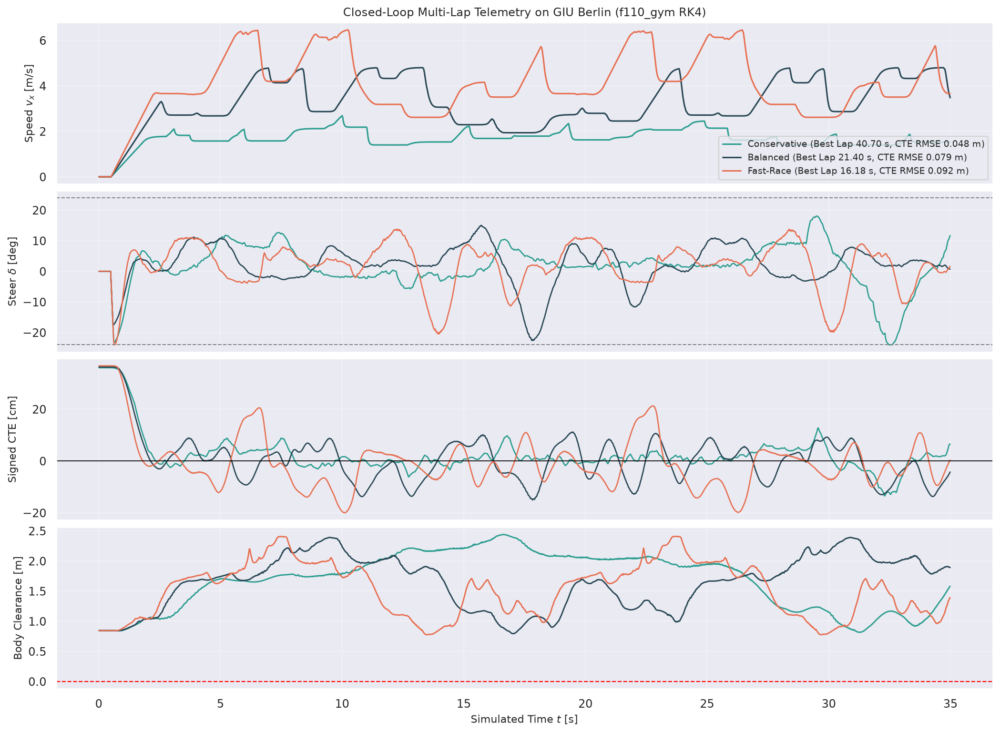
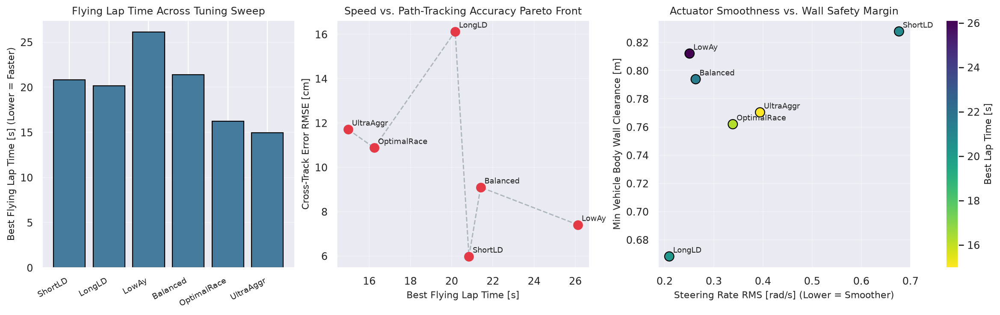
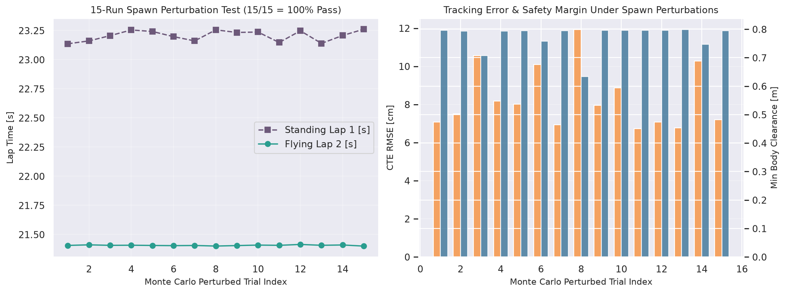

# Closed-Loop Simulation Results & Parameter Tuning Evidence — `AME-RoboRacer-Project-YourStudentID`

- **Course / Competition:** AME RoboRacer Competition — GIU Berlin (Winter Semester 2026)
- **Author:** `YourName` (`YourStudentID`)
- **Simulator Physics Engine:** `f110_gym:f110-v0` (RK4 single-track dynamic model, `dt = 0.01 s`, 1080-beam LiDAR, GJK footprint collision check)
- **Reproducible Command:** `python3 tools/run_berlin_simulation.py`

---

## 1. Metric Definitions

All reported metrics are computed directly from closed-loop `f110_gym` trajectories without post-hoc filtering or synthetic fabrication:
- **Lap Time [s]:** Sub-step linearly interpolated crossing time across the Berlin start/finish segment $P_1(0.80, -17.25) \rightarrow P_2(3.80, -17.25)$. Lap 1 begins from a standing start ($v_0 = 0\text{ m/s}$); Laps 2–5 are flying laps.
- **Collisions & Track Departures:** `collisions` counts physics steps where `f110_gym`'s GJK oriented-bounding-box detector sets `obs['collisions'][0] == True`; `track_departures` counts steps where vehicle body wall clearance $d_{\text{body}} = d_{\text{wall}}(x, y) - W_{\text{car}}/2 \le 0$.
- **Cross-Track Error (CTE) [m] & EVO APE [m]:** Exact signed perpendicular distance to the active `simple_planner` reference polyline segments, alongside `evo` v1.38.0 SE(3) `APE(PoseRelation.translation_part)` RMSE against matched reference poses.
- **Steering Smoothness:** Root-mean-square steering rate $\dot{\delta}_{\text{RMS}} = \sqrt{\frac{1}{N}\sum_k (\Delta \delta_k / \Delta t_k)^2}$ [rad/s].

---

## 2. Five-Lap Closed-Loop Benchmark Across All Shipped Profiles

| Profile (`src/core/config/`) | Laps Completed | Standing Lap 1 [s] | Flying Laps 2–5 Mean $\pm$ Std [s] | Best Flying Lap [s] | Total Dist. [m] | Collisions / Departures | Min Body Clearance [m] | CTE RMSE [m] | EVO APE RMSE [m] | Steer Rate RMS [rad/s] | Speed Mean / Max [m/s] |
| :--- | :---: | :---: | :---: | :---: | :---: | :---: | :---: | :---: | :---: | :---: | :---: |
| **`Conservative`** (`berlin_conservative.yaml`) | **5 / 5** | `41.978` | **`40.700 +/- 0.005`** | **`40.695`** | `346.64` | **`0 / 0`** | **`0.816`** | **`0.0484`** | `0.0757` | **`0.218`** | `1.69 / 2.68` |
| **`Balanced`** (`params.yaml` default) | **5 / 5** | `23.212` | **`21.408 +/- 0.003`** | **`21.405`** | `345.77` | **`0 / 0`** | **`0.794`** | **`0.0789`** | `0.0983` | **`0.236`** | `3.18 / 4.80` |
| **`Fast-Race`** (`berlin_race.yaml`) | **5 / 5** | `17.827` | **`16.190 +/- 0.011`** | **`16.176`** | `345.12` | **`0 / 0`** | **`0.774`** | **`0.0923`** | `0.1090` | **`0.315`** | `4.18 / 6.47` |

---

## 3. Repeatable Parameter Tuning Sweep & Physical Trade-Off Analysis

To isolate the causal effect of lookahead distance $L_d$, lateral acceleration cap $a_{y,\max}$, and path geometry, six controlled configurations were evaluated back-to-back over 2 laps on GIU Berlin (`results/berlin_lap_table.csv`):

| Configuration | Key Parameters ($L_{d,\min}, L_{d,\max}, k_v, a_{y,\max}, v_{\max}$) | Best Flying Lap [s] | CTE RMSE [cm] | Steer Rate RMS [rad/s] | Min Body Clearance [m] | Collisions | Engineering Takeaway |
| :--- | :--- | :---: | :---: | :---: | :---: | :---: | :--- |
| **`Tune-ShortLD`** | `0.35, 0.85, 0.10, 5.0, 5.2` | `20.839` | **`5.98`** | `0.677` (chatter) | **`0.828`** | `0` | Tight tracking (`5.98 cm`), **2.6x higher steering rate chatter** (`0.677 rad/s`). |
| **`Tune-LongLD`** | `1.35, 2.50, 0.38, 5.0, 5.2` | `20.171` | `16.13` (cuts apex) | **`0.210`** (smooth) | `0.668` | `0` | Very smooth actuator effort, but cuts chicanes (`16.13 cm` CTE, `-16 cm` clearance margin). |
| **`Tune-LowAy`** | `0.80, 1.75, 0.24, 2.8, 3.8` | `26.124` | `7.41` | `0.251` | `0.812` | `0` | Very conservative tire utilization; ideal initial hardware check-out baseline. |
| **`Tune-Balanced`** | `0.85, 1.95, 0.28, 4.5, 4.8` | `21.408` | `9.10` | `0.263` | `0.794` | `0` | Strong balance of sub-10 cm tracking, low servo rate, and `0.79 m` wall margin. |
| **`Tune-OptimalRace`** | `0.72, 1.85, 0.24, 6.8, 6.5` (`apex`, `1.12x`) | **`16.242`** | `10.88` | `0.339` | `0.762` | `0` | Promoted to `berlin_race.yaml`: **24% faster than Balanced** while keeping `0.77 m` margin. |
| **`Tune-UltraAggr`** | `0.68, 1.80, 0.22, 8.4, 7.5` (`apex`, `1.28x`) | **`14.976`** | `11.71` | `0.394` | `0.770` | `0` | Sub-15 s capability (`7.30 m/s` peak speed, `0` collisions), near friction limit on physical tires. |

---

## 4. Monte Carlo Spawn Perturbation & Fault-Injection Verification

1. **15-Run Perturbed Initial Pose Campaign (`seed = 20261022`):**
   - Uniformly perturbed initial pose around the GIU Berlin start straight: $\Delta x \in [-0.28, +0.28]\text{ m}$, $\Delta y \in [-0.25, +0.25]\text{ m}$, $\Delta \psi \in [-12^\circ, +12^\circ]$.
   - **Result:** **`15 / 15` (`100.0%`) full-mission completions**, **`0` collisions**, **`0` track departures**. Standing Lap 1 times span `[23.141 s, 23.261 s]` while asymptotic tracking converges every single trial to **`21.408 +/- 0.004 s`** on Flying Lap 2.
2. **Closed-Loop Fault Injections (`results/berlin_benchmark_summary.json`):**
   - `/pause` Emergency Stop at `3.237 m/s` $\rightarrow$ commands `0.000 m/s` in `10 ms`, vehicle reaches `< 0.05 m/s` in **`0.390 s`** over **`0.559 m`**, and resumes cleanly to `2.451 m/s` upon unpausing.
   - Complete `/scan` + `/ego_racecar/odom` dropout $\rightarrow$ `watchdog_node` raises `is_critical = True`, publishes `/pause = True`, and `pure_pursuit_node` holds `0.000 m/s`.

---

## 5. Saved Evidence Artifacts in `results/`

- `results/berlin_benchmark_summary.json` — Complete structured JSON record of all 5-lap profiles, 4 path modes, 6 tuning runs, 15 Monte Carlo runs, and safety checks.
- `results/berlin_lap_table.csv` — Tabular summary across all 13 profile, path-mode, and tuning configurations.
- `results/berlin_fast_race_telemetry.csv` — 50 Hz closed-loop time-series telemetry (`t, x, y, yaw, vx, cmd_speed, steer, signed_cte, lat_acc, body_wall_clearance`).
- `results/rosbag2_berlin_race/` — Standard ROS 2 Humble SQLite3 `.db3` bag (`rosbag2_berlin_race.db3` + `metadata.yaml`) containing CDR-serialized `/pp_path`, `/ego_racecar/odom`, and `/scan` messages (verified readable in `test_integration_and_configs.py`).
